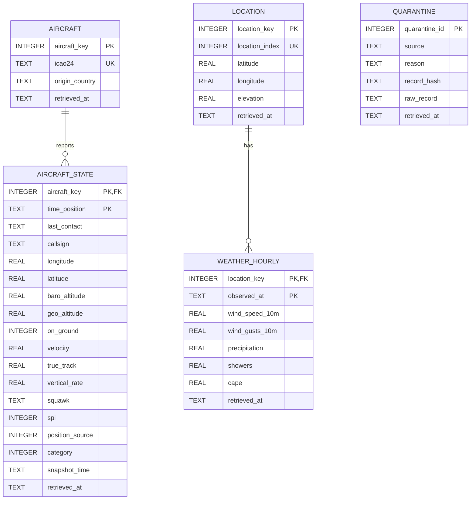

# flight-delay-weather-analysis

## The Question

This integrated dataset will allow us to predict and explain flight route anomalies and ground arrival delays caused by localized severe weather events. By combining real-time flight vectors with atmospheric metrics (such as wind gusts and convective precipitation), we can model how adverse conditions alter standard descent profiles and cruise velocities. Ultimately, this analysis will help determine the specific weather thresholds that disproportionately increase airspace congestion around major flight corridors.

## Data Sources

Detailed documentation, licensing terms, and metadata schemas for each source are in the source cards: [docs/sources.md](docs/sources.md).

- **OpenSky Network (ADS-B flight telemetry):** live and historical state vectors of global flights. See [docs/sources.md#opensky-network](docs/sources.md#opensky-network).
- **Open-Meteo API (atmospheric and weather metrics):** real-time and forecasted meteorological data. See [docs/sources.md#open-meteo](docs/sources.md#open-meteo).

### Attribution

- Flight data provided by [The OpenSky Network](https://opensky-network.org).
- Weather data provided by [Open-Meteo.com](https://open-meteo.com) under [CC BY 4.0](https://creativecommons.org/licenses/by/4.0/).

## How to Run

Follow the steps below to set up the environment, run the ingestion pipeline, and build the database from a clean clone.

### Prerequisites

- Python 3.10+
- Git

### Setup and Execution

1. **Clone the repository**

   ```bash
   git clone https://github.com/se-230717022/flight-delay-weather-analysis.git
   cd flight-delay-weather-analysis
   ```

2. **Create and activate a virtual environment** (recommended)

   ```bash
   python -m venv venv

   # macOS / Linux
   source venv/bin/activate

   # Windows
   venv\Scripts\activate
   ```

3. **Install dependencies**

   ```bash
   pip install -r requirements.txt
   ```

4. **Configure environment variables**

   Copy the example file and fill in your credentials:

   ```bash
   cp .env.example .env
   ```

   Open `.env` and set:

   ```
   OPENSKY_USERNAME=your_username_here
   OPENSKY_PASSWORD=your_password_here
   ```

   Note: OpenSky allows limited anonymous requests, but using valid credentials avoids strict anonymous rate limits. Open-Meteo requires no API key. Never commit `.env`; it is listed in `.gitignore`.

5. **Run the ingestion script** (single command, from the project root)

   ```bash
   python src/ingest.py
   ```

6. **Verify the output**

   Raw, unmodified JSON snapshots with UTC retrieval timestamps are written to `data/raw/`. Earlier files are never overwritten; every run creates new files:

   ```
   data/raw/opensky/YYYYMMDDTHHMMSSZ.json
   data/raw/openmeteo/YYYYMMDDTHHMMSSZ.json
   ```

   A run summary (sources fetched, number of records or files per source, and any failures) is printed to the terminal.

7. **Build the database from the landed raw files** (single command, from the project root; never calls the API)

   ```bash
   python src/load.py
   ```

   This creates `data/flights.db` from scratch if it does not exist, and can be run any number of times: the result is always the same. A run summary (files read, rows per table, values cleaned, quarantined records, `foreign_key_check`, `STATUS`) is printed at the end.

8. **Run the checks** (they run on a temporary copy, never on the real database)

   ```bash
   python src/checks.py
   ```

   Expected: six `PASS` lines (duplicate natural key, orphan event, NULL key, wrong type, idempotence, atomicity) and `ALL CHECKS PASSED`.

9. **Run the analytical query** (optional)

   ```bash
   sqlite3 data/flights.db < sql/queries/01_wind_and_nearby_traffic.sql
   ```

   (or open `data/flights.db` in any SQLite client and run the file; SQLite 3.37+ is required for `STRICT` tables.)

## Repository Structure

```
flight-delay-weather-analysis/
├── README.md            # Project overview, setup, data model, and execution guide
├── .gitignore           # Ignores secrets, local caches and the database file (data/*.db)
├── .env.example         # Template for required environment variables
├── requirements.txt     # Frozen list of project Python dependencies
├── data/
│   ├── raw/             # Landing zone for raw, untouched JSON API responses
│   │   ├── opensky/     # Snapshots from OpenSky Network
│   │   └── openmeteo/   # Snapshots from Open-Meteo API
│   └── flights.db       # SQLite database built by load.py (derived, not committed)
├── sql/
│   ├── schema.sql       # All tables (STRICT), keys and constraints; safe to run repeatedly
│   └── queries/
│       └── 01_wind_and_nearby_traffic.sql   # Analytical query (grain stated in the file)
├── src/
│   ├── ingest.py        # M1: extraction, retries, and logging (lands raw files)
│   ├── db.py            # M2: connect() (foreign_keys = ON) and shared helpers
│   ├── load.py          # M2: loads raw files into the schema (idempotent, atomic)
│   └── checks.py        # M2: six checks run against a temporary copy of the database
└── docs/
    └── sources.md       # Data source cards detailing schema, licensing, and known issues
```

## Data Model

The database is SQLite (`data/flights.db`), built by `python src/load.py` from the raw files in `data/raw/`. The schema is in [sql/schema.sql](sql/schema.sql). Every table is `STRICT`, every entity has a surrogate integer primary key plus its source identifier as `NOT NULL UNIQUE`, every key column is `NOT NULL`, every relationship is a declared and enforced foreign key, and every table keeps `retrieved_at` (the timestamp of the landed raw file the row came from). Timestamps are `TEXT` in ISO 8601 UTC (e.g. `2026-10-20T10:07:07Z`; weather hours as `2026-10-19T00:00Z`).

### ER diagram



### Grain of every table

| Table | One row means... |
|-------|------------------|
| `aircraft` | one aircraft, identified by its ICAO 24-bit transponder address (`icao24`). |
| `aircraft_state` | one reported state (position, speed, altitude, ...) of one aircraft at one position time (`time_position`). |
| `location` | one weather location (airport), identified by its position in the configured location list (`location_index`). |
| `weather_hourly` | the weather values at one location for one hour (`observed_at`). |
| `quarantine` | one raw record that could not be loaded, with the reason, in the file it was retrieved from. |

### Decisions and findings

**Keys.** Entities: `aircraft.icao24` and `location.location_index` (kept as `NOT NULL UNIQUE`; the integer `*_key` columns are surrogate keys so that references never depend on the provider). Events: `aircraft_state` is keyed by `(aircraft_key, time_position)` and `weather_hourly` by `(location_key, observed_at)`. We tested each key on the landed files (8 raw files: 4 OpenSky, 4 Open-Meteo, from 9 and 20 October 2026) before writing the schema:

- `icao24` is unique per aircraft and never changes its `origin_country` (470 aircraft, 0 with more than one country), so it is a sound entity key.
- `(icao24, time_position)` identifies a state: 0 duplicates inside one snapshot; 802 states landed, of which 12 were the same state seen again in a later snapshot, leaving 790 distinct states. We deduplicate by this key and the most recently retrieved version wins (decided by `retrieved_at`, not by file reading order).
- `(icao24, snapshot time)` was also unique but is not what identifies the event (the same state can be reported in several snapshots), so it was not used as the key.
- `callsign` changes for some aircraft (28 of 470), so it is stored on the event, not on `aircraft`.
- Open-Meteo has no identifier for a location: the first location has no `location_id` at all and the returned coordinates are snapped to the weather grid (e.g. 41.258 instead of the requested 41.2753). We therefore identify a location by its position in the request (0..4), and the three same-day files contained identical hourly values, so `(location_key, observed_at)` held with repeated fetches.

**Missing values.** A `null` in OpenSky (e.g. altitude, velocity, vertical rate for aircraft on the ground, or a missing squawk) means "not reported"; it is stored as `NULL`, not as zero. The same holds for `null` in Open-Meteo. A non-null value that does not fit its column (text where a number belongs, an unparseable timestamp) is converted to `NULL` and counted in the run summary line `values cleaned`. No such value appeared in the landed data so far (count 0). We do not decide how to treat outliers (that is M3).

**Unknown references.** Entities are created from the records themselves (an aircraft is added the first time a state mentions it), so a state can only point to an unknown entity if its identifying key is missing. Such a record (missing `icao24`, or missing/invalid `time_position`, or an unparseable weather hour) goes to the `quarantine` table with the reason and the raw record, and is counted in the run summary; it is never silently dropped and never crashes the load. A structurally broken raw file (invalid JSON, wrong record shape) aborts the whole run instead, and nothing is written (atomicity).

**Change over time.** We use type 1 (keep the latest version): if an aircraft's `origin_country` or a location's coordinates change, the row is updated in place by the most recently retrieved file, and the surrogate key stays the same. History is not kept. Callsign is stored per state, so its history is kept. The run summary reports how many new aircraft and locations appeared in each run so that a split history (a renamed or renumbered entity) is noticed immediately.

**Loader behaviour.** Idempotent (`INSERT ... ON CONFLICT ... DO UPDATE`, only replacing a row when the incoming `retrieved_at` is the same or newer; no `INSERT OR REPLACE`, no `to_sql`), atomic (the whole load runs in a single transaction, `with con:`), parameterised (every value goes through a `?` placeholder), and every connection goes through `connect()` in `src/db.py`, which sets `PRAGMA foreign_keys = ON` first. `src/checks.py` demonstrates all of this on a temporary copy.

**Known issues.**
- Open-Meteo is requested with `forecast_days=1`, so hours later than the retrieval time are forecasts, not observations. `weather_hourly` does not distinguish them: a later run overwrites a forecast hour with newer values (latest `retrieved_at` wins). Separating forecast from observed values is left for M3.
- 3 of the 12 states seen again in a later snapshot have a different `baro_altitude` than in the first snapshot. The latest retrieved version is kept.
- OpenSky `callsign` values are stored exactly as received, including trailing spaces. `icao24` is trimmed and lower-cased only so that it can be used as a key.
- The OpenSky response used here has 17 fields per state; `category` (an 18th field, only returned on request) is therefore `NULL`. `sensors` is not stored.
- Locations are identified by their order in the `OPENMETEO_LOCATIONS` setting (by default 0 = IST, 1 = SAW, 2 = ESB, 3 = ADB, 4 = AYT). Changing the order or the list of locations in `.env` would mix up the history. Airport names are not stored in the database.
- The bounding box and the airport coordinates are rectangular approximations; the analytical query uses a simple 0.25 degree box around each airport instead of a real distance.

### Analytical query

The question connects directly to our project question (weather versus air traffic around major airports): *at each weather location, how windy was it, and how much air traffic was reported close to it (within 0.25 degrees, about 28 km)?* The query is in [sql/queries/01_wind_and_nearby_traffic.sql](sql/queries/01_wind_and_nearby_traffic.sql). Its result grain is one row per location. Weather and traffic are aggregated to the location grain in separate CTEs before they are joined, so the join cannot multiply rows.

```sql
WITH weather AS (
    SELECT location_key,
           COUNT(*)            AS weather_hours,
           ROUND(AVG(wind_gusts_10m), 1) AS avg_gust_kmh,
           MAX(wind_gusts_10m) AS max_gust_kmh
    FROM weather_hourly
    GROUP BY location_key
),
traffic AS (
    SELECT l.location_key,
           COUNT(*)                        AS nearby_states,
           COUNT(DISTINCT s.aircraft_key)  AS nearby_aircraft
    FROM location AS l
    JOIN aircraft_state AS s
      ON ABS(s.latitude  - l.latitude)  <= 0.25
     AND ABS(s.longitude - l.longitude) <= 0.25
    GROUP BY l.location_key
)
SELECT l.location_index, l.latitude, l.longitude,
       w.weather_hours, w.avg_gust_kmh, w.max_gust_kmh,
       COALESCE(t.nearby_states, 0)   AS nearby_states,
       COALESCE(t.nearby_aircraft, 0) AS nearby_aircraft
FROM location AS l
JOIN weather AS w ON w.location_key = l.location_key
LEFT JOIN traffic AS t ON t.location_key = l.location_key
ORDER BY w.avg_gust_kmh DESC;
```

Output (on the landed raw files):

| location_index | latitude | longitude | weather_hours | avg_gust_kmh | max_gust_kmh | nearby_states | nearby_aircraft |
|---|---|---|---|---|---|---|---|
| 0 | 41.258053 | 28.772957 | 96 | 20.3 | 41.4 | 61 | 50 |
| 1 | 40.886364 | 29.251366 | 96 | 14.4 | 35.6 | 21 | 21 |
| 4 | 36.9086 | 30.838587 | 96 | 14.1 | 33.8 | 21 | 19 |
| 3 | 38.287888 | 27.12891 | 96 | 9.9 | 22.3 | 3 | 3 |
| 2 | 40.119682 | 32.95298 | 96 | 8.3 | 24.8 | 1 | 1 |

Istanbul (index 0) has both the highest average gusts and the most nearby aircraft. With only a few snapshots this is a first look, not a conclusion: aircraft counts depend on when the snapshots happened to be taken.

### How to build the database

From a fresh clone, with the raw data landed in `data/raw/` (by `python src/ingest.py`):

```bash
pip install -r requirements.txt
python src/load.py      # builds data/flights.db from the raw files (run it twice: same result)
python src/checks.py    # six checks on a temporary copy: all must print PASS
```

The database file is derived data and is not committed (`data/*.db` is in `.gitignore`); anyone with the raw files can rebuild it with the commands above.

## Status

M2 — schema and load complete.

## Team

| Name | GitHub |
|------|--------|
| Enes Akdeniz (230717022) | [@se-230717022](https://github.com/se-230717022) |
| Nihat Avcı (230719001) | [@se-230719001](https://github.com/se-230719001) |
| Mehmetali Açık (240719001) | [@se-240719001](https://github.com/se-240719001) |