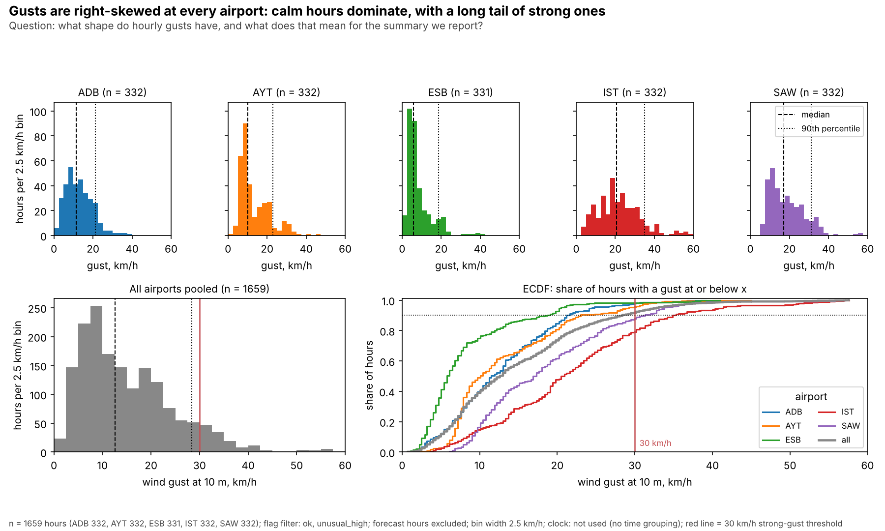
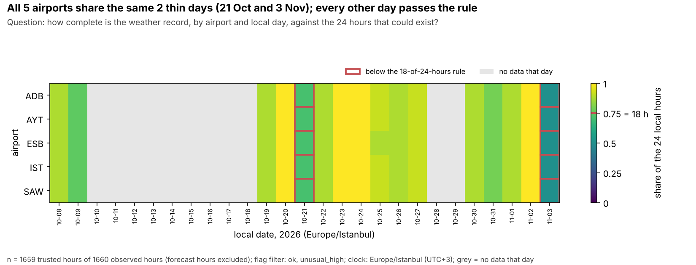
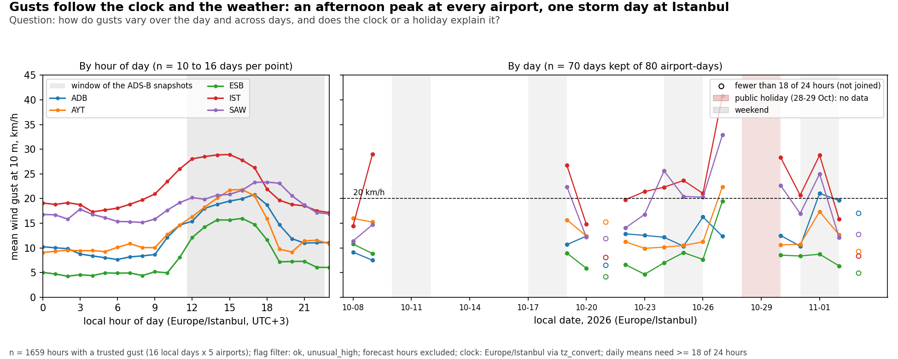
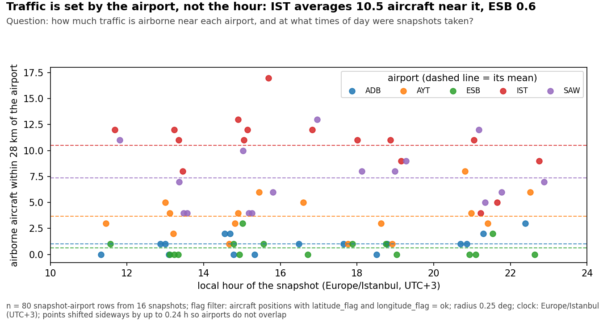
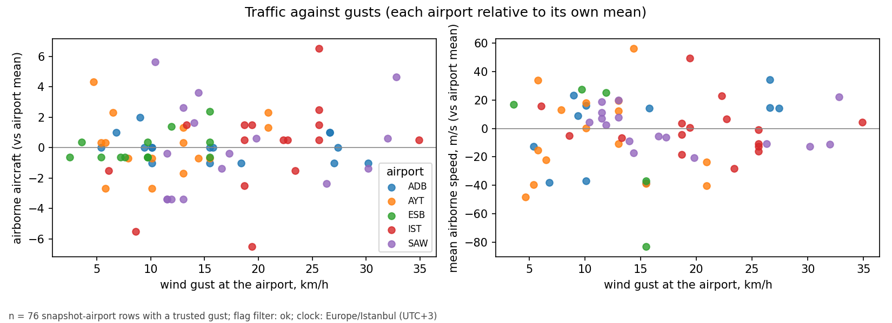
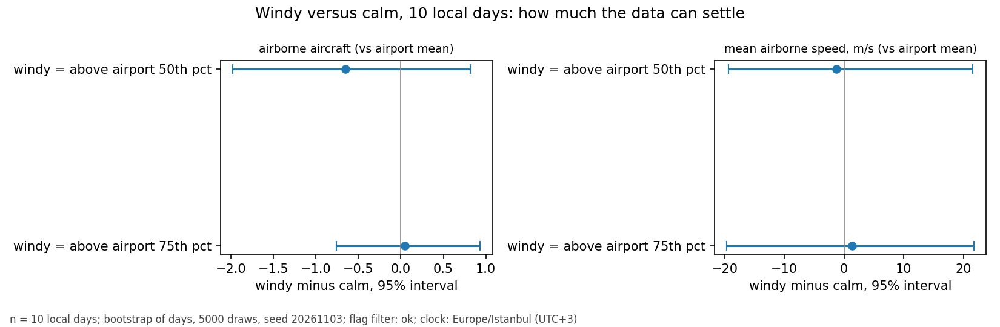
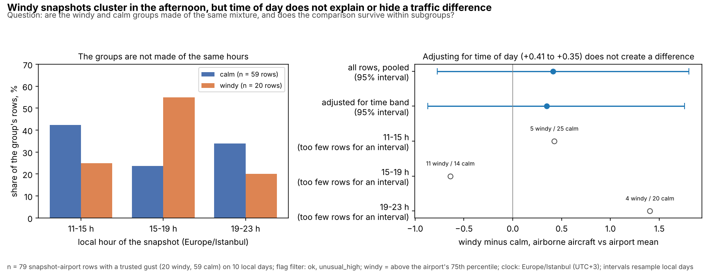

# Exploratory Analysis — flight-delay-weather-analysis

## 1. Summary

**Question:** do stronger wind gusts go together with more or faster airborne traffic near five Turkish airports (IST, SAW, ESB, ADB, AYT)? Exploration finds **no detectable link**: over 79 usable snapshot-airport rows from 16 ADS-B snapshots on 10 local days, gust and airborne count have a Spearman correlation of +0.14 (95% interval [-0.22, +0.34]), and the windy-minus-calm difference is +0.41 aircraft [-0.77, +1.80]. We are not very sure of anything about traffic: ten days is little, snapshots were only taken between 11:34 and 22:38 local time, and about 49 comparisons were looked at. The weather side is firmer: gusts are right-skewed, peak in the local afternoon, and the choice of flag filter changes the picture at Ankara and Antalya. What could overturn the traffic result is more snapshots on more days spread over the whole day. No M3 feedback was received, so no M3 issues were fixed; three items for the M3 register are proposed in section 8.

All numbers use the flag filter `ok` + `unusual_high` for gusts, forecast hours excluded, and the clock `Europe/Istanbul` (UTC+3) unless a line says otherwise. Everything is reproduced by `notebooks/m4_eda.ipynb`.

## 2. Raw versus cleaned

The key number is the **mean wind gust (km/h) over all hours and airports**. Queries (abridged; full text in `sql/queries/05_gust_mean_raw.sql` and `06_gust_mean_clean.sql`, values bound as parameters):

```sql
-- 05, M2 table as loaded, no flags, forecast hours included (:observed_only = 0)
SELECT m.iata, COUNT(*) AS n_hours, COUNT(w.wind_gusts_10m) AS n_gust, ROUND(AVG(w.wind_gusts_10m), 2) AS mean_gust_kmh
FROM weather_hourly AS w JOIN location_airport AS m ON m.location_key = w.location_key GROUP BY m.iata;

-- 06, cleaned layer; flag filter :f1..:f3 = ok, unusual_high; forecast hours excluded
SELECT m.iata, COUNT(*) AS n_hours,
       CASE WHEN w.wind_gusts_10m_flag IN (:f1, :f2, :f3) THEN w.wind_gusts_10m END AS gust
FROM weather_hourly_clean AS w JOIN location_airport AS m ON m.location_key = w.location_key
WHERE datetime(w.observed_at) <= datetime(w.retrieved_at);   -- then AVG(gust) per airport and overall
```

| Airport | Raw, all hours (n) | Raw, forecasts removed (n) | **Clean, ok + unusual_high (n)** | Clean, ok only (n) |
|---|---|---|---|---|
| ADB | 13.00 (384) | 12.77 (332) | **12.77 (332)** | 12.62 (330) |
| AYT | 12.88 (384) | 13.19 (332) | **13.19 (332)** | 11.61 (305) |
| ESB | 8.14 (384) | 8.20 (332) | **8.21 (331)** | 6.34 (294) |
| IST | 21.13 (384) | 21.92 (332) | **21.92 (332)** | 21.41 (327) |
| SAW | 18.28 (384) | 18.52 (332) | **18.52 (332)** | 18.18 (329) |
| **All** | **14.69 (1920)** | 14.92 (1660) | **14.93 (1659)** | 14.23 (1585) |

Cleaning moves the mean from 14.69 to 14.93 km/h. Almost all of it comes from removing 260 forecast hours (13.5% of the rows; the Open-Meteo files contain hours after their retrieval, I-20), which raises the mean by 0.23 and Istanbul's by 0.79. The flag filter removes one hour (a stuck value at ESB). The strict filter `ok` only would drop 75 more hours, almost all `unusual_high`, and lower the mean to 14.23 and Ankara's to 6.34.

## 3. The question and its summary

**Question:** how strong are the strong gusts at each airport, so that "windy" hours can be compared with calm ones? The summary is the **90th percentile of the hourly gust**, because the question is about strong hours; the mean is dominated by calm hours and the maximum rests on one hour. Alternatives: the median (the typical hour), the mean, and the share of hours at or above 30 km/h.

| Airport | n (hours) | Mean | Median | **90th pct** | 95th pct | Hours ≥ 30 km/h (share) |
|---|---|---|---|---|---|---|
| IST | 332 | 21.9 | 20.7 | **34.9** | 41.4 | 69 (21%) |
| SAW | 332 | 18.5 | 17.1 | **31.3** | 33.8 | 40 (12%) |
| AYT | 332 | 13.2 | 10.1 | **23.0** | 29.2 | 15 (5%) |
| ADB | 332 | 12.8 | 11.5 | **21.2** | 24.6 | 7 (2%) |
| ESB | 331 | 8.2 | 5.8 | **18.7** | 20.5 | 6 (2%) |

Flag filter `ok` + `unusual_high`; km/h. The mean, 90th and 95th percentiles and the share rank the airports IST > SAW > AYT > ADB > ESB. **The median does not:** ADB has the higher typical hour (11.5 against 10.1 km/h) but AYT the stronger tail (23.0 against 21.2). The median answers "which airport is windier on an ordinary hour", the 90th percentile "which reaches strong gusts more often". The difference is small and rests on 16 days (F-02).

## 4. What the data is made of



**Shape.** Histograms at 1, 2.5 and 5 km/h were compared on the pooled data: at 1 km/h the 330 hours per airport are noise (4 to 8 "peaks"), at 5 km/h the body is two or three bars. We use **2.5 km/h**, where ADB, ESB and SAW show one main peak; AYT and IST keep weak extra bumps of a few hours that we do not interpret. The ECDF (same figure) agrees. Gusts are right-skewed at every airport: the mean is above the median everywhere, and there is a long upper tail with no clipping. IST's top hours form a small cluster from one storm day (27 Oct). So the mean overstates a typical hour, the median describes it, and the 90th percentile describes the tail.



**Coverage.** Hours per airport against the 633 UTC hours between the first and last observed hour:

| Airport | Stored in M2 | Observed (no forecasts) | Trusted, `ok` | Trusted, `ok` + `unusual_high` |
|---|---|---|---|---|
| ADB | 384 | 332 | 330 | 332 |
| AYT | 384 | 332 | 305 | 332 |
| ESB | 384 | 332 | 294 | 331 |
| IST | 384 | 332 | 327 | 332 |
| SAW | 384 | 332 | 329 | 332 |

Only 61% of the possible hours were ever stored (the ingestion was run by hand, I-18), and every airport has data on the same 16 local days. The thin days are 21 Oct (17 hours) and 3 Nov (12 hours) at every airport.

**Coverage rule.** A **local-day mean gust needs at least 18 of 24 hours** with a trusted gust (75%). Reason: gusts have a daily cycle (section 5), so a mean over a few hours describes those hours, not the day. The windy-versus-calm comparison has no partial-period aggregate: its unit is one snapshot at one airport, and days are only the resampling unit.

| Filter | Airport | Days | Days kept | Highest daily mean, no rule | Highest, with rule |
|---|---|---|---|---|---|
| ok + unusual_high | all five | 16 | 14 | IST 40.9, SAW 32.9, AYT 22.4, ADB 21.1, ESB 19.5 | same |
| ok only | AYT | 16 | 11 | 18.8 | 15.3 |
| ok only | ESB | 16 | 9 | 10.2 | 8.3 |
| ok only | IST | 16 | 13 | 36.5 | 29.0 |

With the reported filter the rule drops 10 of 80 airport-days and changes none of the maxima. With the strict filter it drops 19, because the filter itself removes hours, and it changes the highest daily mean at three airports: a day built from few hours is not a day.

**Flag filter.** Two filters on the same results:

| Result | `ok` + `unusual_high` (reported) | `ok` only |
|---|---|---|
| ESB 90th percentile, km/h | 18.7 | 11.9 |
| Days passing the 18-of-24 rule at ESB / AYT | 14 / 14 | 9 / 11 |
| Windy minus calm, airborne aircraft [95% interval] | +0.41 [-0.77, +1.80] | +0.05 [-0.76, +0.93] |

We report `ok` + `unusual_high`. The flagged hours are real values that M3 kept unchanged; the strict filter removes the top of each airport's distribution, which is what "windy" is about, and thins Ankara and Antalya (I-11 flags ordinary afternoon gusts at ESB). The traffic reading is the same under both filters, so the choice does not drive the result.

## 5. Time

**Clock.** Local time, converted explicitly with `tz_convert`, because the questions are about the day as it is lived. The conversion is a constant UTC+3 (checked in the data; Turkey has no daylight saving).

**Edges.** In UTC the first weather day (8 Oct) looks complete with 24 hours; in local time it starts at 03:00 and has 21 hours, so it passes the rule. The last local day, 3 Nov, ends at 11:00 with 12 hours and fails it, so its daily mean is not used. The first ADS-B snapshot is on 9 Oct and the last on 3 Nov at 11:34.



**Two scales.** By hour of day, gusts peak between 15:00 and 18:00 local at every airport, and the afternoon mean (12:00 to 17:59) is 1.3 to 3.2 times the night mean (Ankara the most). In UTC that peak would read as noon. By day, IST and SAW move more between days than between hours because of the 27 Oct storm, while the daily and hourly ranges are similar at ADB, AYT and ESB. Day of week cannot be compared: there are 0 to 3 days per weekday.



**Calendar.** Republic Day (29 Oct) and its half-day eve fall in a gap with no weather or snapshots, so no holiday is in the numbers. Weekends: 4 of the 16 weather days and 3 of the 10 snapshot days. **Time of day is not controlled:** all 16 snapshots were taken between 11:34 and 22:38 local, none at night or in the morning, so the traffic side covers the afternoon and evening only.

## 6. Relationships



The scatter plots come first: each airport relative to its own mean, no visible trend. Coefficients (rows with a trusted gust; interval resamples local days):

| Outcome | Rows | Pearson [95%] | Spearman [95%] |
|---|---|---|---|
| Airborne aircraft vs airport mean | 79 | +0.12 [-0.17, +0.30] | +0.14 [-0.22, +0.34] |
| Mean airborne speed vs airport mean | 66 | +0.12 [-0.18, +0.39] | +0.01 [-0.28, +0.34] |

**Spearman describes the count better**: counts are small integers with many ties and gusts are skewed. For speed, Pearson is moved by a few extreme values that rest on one or two aircraft: 20 of the 66 speed values come from fewer than 3 aircraft, and with a minimum of 3 aircraft (46 rows) the correlations are -0.07 (Pearson) and -0.20 (Spearman).

**What drives it.** No single event: no snapshot caught the 27 Oct storm (snapshot gusts at most 16.6 km/h, IST peaked at 57.6), and removing that day moves Spearman from +0.14 to +0.16; removing the top 5% of gusts gives +0.11. Shared patterns do not create it either: centring gust and traffic within time-of-day bands gives +0.11, within snapshots +0.09. Within airports the picture splits (ESB +0.52, IST +0.41, SAW +0.22, AYT -0.16, ADB -0.34), with only 15 or 16 rows each, a hypothesis for a larger sample and not a result.

## 7. The comparison

**Windy minus calm.** Windy means a gust at or above the airport's own 75th percentile of trusted hours (decided before looking at any traffic outcome). The difference in airborne aircraft relative to the airport mean is **+0.41, 95% interval [-0.77, +1.80]** (20 windy and 59 calm rows; unit: local day, 10 days, bootstrap of days with 5,000 draws, seed 20261103). Speed: +5.89 m/s [-19.42, +31.50]. Rows are not independent (they share snapshots and days), so resampling rows would have given a much narrower and wrong interval.



**Composition.** The groups are not made of the same hours: 55% of the windy rows but 24% of the calm rows fall between 15:00 and 19:00 (windy rows also include only 1 at IST against 6 at ADB and ESB, but the outcome is already relative to each airport's mean). Adjusting for the time-of-day band gives +0.35 [-0.87, +1.76], so the pooled sign does not reverse. Within bands the differences are +0.43 (11-15 h, 5 windy and 25 calm rows), -0.64 (15-19 h, 11 and 14) and +1.40 (19-23 h, 4 and 20): they disagree in sign, each from a handful of rows.



**Looks.** Roughly **49 comparisons and coefficients** were looked at: 4 cut-off and outcome variants, 5 leave-one-airport-out runs, 4 for the second flag filter, 4 time-band variants and 32 correlations and driver checks. The primary comparison was fixed beforehand, but one striking interval among 49 looks would be a hypothesis, not a finding. Here every interval of the primary comparison includes 0, and moving the windy cut-off to the median even flips the sign (-0.53 [-1.82, +0.84]).

## 8. Findings

| ID | Finding | Evidence | Label | What would change it | Explored by |
|---|---|---|---|---|---|
| F-01 | Hourly gusts are right-skewed at every airport (mean above median everywhere), so the typical hour is calm and a long tail carries the strong hours; we summarise the typical hour with the median and strong hours with the 90th percentile | `figures/fig05_gust_shape.png`; sections 0b, 0c | Exploratory | A different season or wind regime; a longer record than 16 days | Mehmetali Açık |
| F-02 | ADB has the higher median gust (11.5 vs 10.1 km/h) but AYT the higher 90th percentile (23.0 vs 21.2 km/h): the two summaries rank them differently, answering "typical hour" versus "strong hours" | Section 0b, rank tables | Exploratory | More days (the gap is small); a different tail definition | Mehmetali Açık |
| F-03 | The strict flag filter (`ok` only) cuts the top of each airport's distribution: ESB's 90th percentile falls from 18.7 to 11.9 km/h and only 9 of 16 ESB days (11 at AYT) pass the 18-of-24-hours rule, against 14 of 16 at every airport with `ok` + `unusual_high` | Section 1b tables; `figures/fig01_weather_coverage.png` | Confirmed (arithmetic) | A different `ROBUST_Z_THRESHOLD` or a per-hour-of-day baseline in `clean.py` (I-11) | Enes Akdeniz |
| F-04 | The raw mean gust of 14.69 km/h becomes 14.93 km/h in the cleaned layer (forecast hours -260, one stuck value NULLed); the strict filter would give 14.23 km/h and drop ESB's mean from 8.21 to 6.34 km/h | Section 0 (queries `05`, `06`) | Confirmed (arithmetic) | Nothing, unless the flag rules change | Enes Akdeniz |
| F-05 | Gusts peak between 15:00 and 18:00 local time at every airport; the afternoon mean is 1.3 to 3.2 times the night mean (Ankara the most). In UTC the peak would read as noon | `figures/fig06_time_scales.png`; section 4c | Exploratory | Night and morning data from other days; another season | Enes Akdeniz |
| F-06 | All 16 ADS-B snapshots were taken between 11:34 and 22:38 local time, so time of day confounds the windy-versus-calm comparison: 55% of the windy rows but 24% of the calm rows fall between 15:00 and 19:00 | `figures/fig07_composition_windy_calm.png`; section 4d | Confirmed (composition) | Snapshots spread over the whole day | Nihat Avcı |
| F-07 | The edge days and holidays are handled: 8 Oct (21 hours) passes the rule, 21 Oct (17) and 3 Nov (12) fail it, and Republic Day (28-29 Oct) falls in a gap with no data, so no holiday is in the numbers | Section 4c edge and calendar tables | Confirmed (arithmetic) | Data collected on a holiday | Enes Akdeniz |
| F-08 | No relationship between gusts and airborne traffic is visible: Spearman +0.14 [-0.22, +0.34] and Pearson +0.12 for the count, +0.01 and +0.12 for the mean speed (n = 79 and 66 rows, 10 days); the clouds in the scatter plots are flat | `figures/fig03_traffic_vs_gust.png`; section 3b | Exploratory | More snapshots on more days, spread over the day; a model with hour and airport | Nihat Avcı |
| F-09 | One event does not drive it: no snapshot caught the 27 Oct storm (snapshot gusts at most 16.6 km/h, IST peaked at 57.6 km/h), and removing that day moves Spearman from +0.14 to +0.16; centring by time-of-day band or by snapshot leaves +0.11 and +0.09 | Section 3b driver table | Confirmed (arithmetic) | A snapshot taken during a storm hour | Nihat Avcı |
| F-10 | Within airports the sign differs (ESB +0.52 and IST +0.41, ADB -0.34 and AYT -0.16 in Spearman), with only 15 or 16 rows each; this is a hypothesis for a larger sample, not a result | Section 3b per-airport table | Exploratory | More snapshots per airport | Mehmetali Açık |
| F-11 | Windy minus calm airborne count is +0.41 aircraft, 95% interval [-0.77, +1.80] over 10 days; it includes 0 under both flag filters, the band-adjusted value is +0.35, the sign flips in the 15-19 h band, and moving the windy cut-off to the median gives -0.53 [-1.82, +0.84]. About 49 comparisons and coefficients were looked at | `figures/fig04_windy_vs_calm.png`; sections 4, 4b, 4d | Exploratory | A third month of data; snapshots in every time band | Nihat Avcı |
| F-12 | A mean airborne speed rests on one or two aircraft in 20 of 66 snapshot-airport rows; with at least 3 aircraft (46 rows) the speed correlation is Pearson -0.07 and Spearman -0.20 instead of +0.12 and +0.01 | Section 3b speed table | Confirmed (arithmetic) for the 20 of 66; exploratory for the correlation | A larger minimum or a count-weighted mean | Mehmetali Açık |

### Back to cleaning

Nothing in the aircraft or weather tables that the cleaned layer got wrong. Three items for the M3 issues register (`docs/cleaning_report.md`); none is changed yet:

1. **I-11 (`unusual_high` gusts).** Filtering on the flag removes the top of every distribution and leaves ESB with 9 of 16 days (F-03). Add this as evidence to I-11 and consider a per-hour-of-day baseline or a higher `ROBUST_Z_THRESHOLD` in `clean.py`.
2. **I-20 (forecast hours).** 260 of 1,920 weather rows are forecasts and are not flagged, so every query must remember `observed_at <= retrieved_at`. Consider an `is_forecast` column in `clean.py`.
3. **Mean airborne speed.** A mean of fewer than 3 aircraft is noise (F-12); add `MIN_AIRBORNE_SPEED` to the M5 and M7 queries.

### Forward to modelling

- **Too few, too clustered rows:** 79 rows from 16 snapshots on 10 days; validate by day, never by row; IST has 1 windy row.
- **Control time of day, airport and weekend:** the gust peak and the snapshots both sit in the afternoon, so use hour or band, airport and weekend as covariates, and gust relative to the airport's own level, instead of a windy/calm cut-off.
- **Outcome:** the airport-centred count of airborne aircraft; mean speed only with at least 3 aircraft.
- **Leakage and timing:** only observed weather hours (I-20), joined at the snapshot's UTC hour; no feature built from the same snapshot's counts, such as `n_ground`.
- **Seasonality and events:** mid-October to early November, with one storm day no snapshot caught; a model may be learning autumn, not wind.

## 9. What we can't say

- **Nothing about causes.** No relationship was found, and none could be excluded: with 10 days an interval of [-0.77, +1.80] aircraft is compatible with a modest effect in either direction.
- **Nothing about night, mornings or holidays.** Snapshots exist only between 11:34 and 22:38 local, and no holiday is in the data.
- **Nothing about other seasons.** The weather covers 16 days between 8 Oct and 3 Nov, with one real storm day.
- **Thin groups.** Each airport has 15 or 16 traffic rows (1 windy row at IST); per-airport results are hypotheses.
- **All findings are exploratory** unless marked confirmed (arithmetic or composition); none has been tested on data we did not look at, and about 49 looks were taken.
